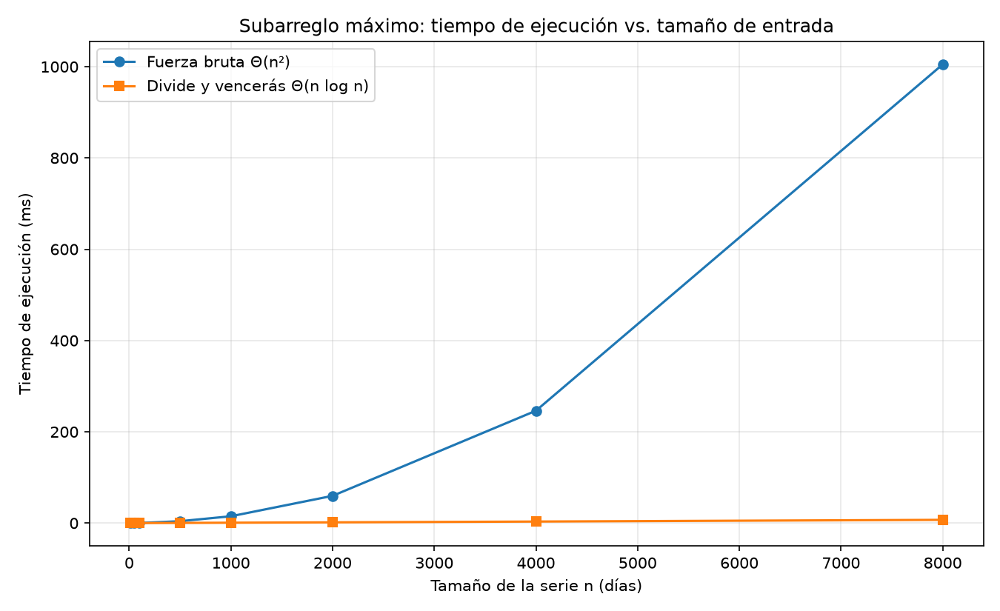
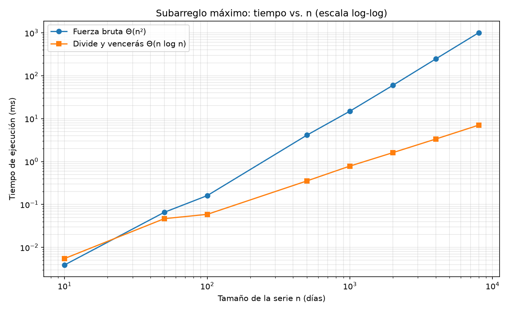

# Laboratorio 2 — Subarreglo máximo por fuerza bruta y por divide y vencerás

Informe de **Brayan Alexis Arango Orrego**, Análisis de Algoritmos.
El problema es encontrar, en el historial de variación de caja de una tienda de
la cooperativa, el tramo de días consecutivos con mayor ganancia acumulada.

## Reproducción

Desde la raíz del repositorio se crea y activa el entorno virtual y se instalan
las dependencias registradas en `requirements.txt`:

```bash
python -m venv venv
source venv/Scripts/activate   # Windows (Git Bash)
# venv\Scripts\activate        # Windows (CMD)
# source venv/bin/activate     # Linux / macOS
pip install -r requirements.txt
```

Con el entorno activo, se entra a la carpeta del laboratorio y se ejecutan las
pruebas y la medición:

```bash
cd laboratorios/lab2-divide-y-vencer
python pruebas.py     # imprime "Todas las pruebas pasaron." o se detiene en el assert que falle
python medicion.py    # muestra los tiempos medidos y guarda las dos gráficas
```

---

## Parte 1 — Implementar y verificar las dos soluciones

Los algoritmos están en [subarreglo.py](subarreglo.py) y la verificación en
[pruebas.py](pruebas.py).

`subarreglo_fuerza_bruta` fija cada día de inicio `i` y va sumando los días
siguientes uno por uno, de modo que la suma de cada par `(i, j)` se obtiene con
una sola suma en lugar de recalcularse. `subarreglo_maximo` parte el rango por
la mitad, resuelve cada mitad recursivamente, calcula con `suma_cruzada` la
mejor racha que atraviesa el centro (un barrido desde `medio` hacia la izquierda
y otro desde `medio + 1` hacia la derecha) y se queda con la mayor de las tres.
No llama a la fuerza bruta ni usa `max()`.

Para verificar, cada caso de `pruebas.py` corre las dos funciones y compara la
**suma** con el valor esperado, no los índices, porque si hay empates cualquier
tramo es válido. También se suma el tramo indicado por los índices para confirmar que da el
mismo valor reportado y que la lista original no se haya modificado. Los casos
cubiertos son: la serie de ocho días de la guía (suma 17), un solo elemento
positivo y uno negativo, una serie toda negativa (la respuesta es el día menos
malo, −2), una toda positiva (la respuesta es la serie completa), la serie
`[-9, 1, 4, 6, -9]` en la que la mejor racha (suma 11) solo aparece en el caso
cruzado, y veinte listas al azar (semilla 2026) donde el resultado de divide y vencerás
se compara contra el de la fuerza bruta. Por último, `suma_cruzada` se prueba
por separado en dos series con resultado conocido.

---

## Parte 2 — Medir y graficar

El experimento completo está en [medicion.py](medicion.py).



En la gráfica anterior, la línea de divide y vencerás casi se confunde con el
eje horizontal. Por eso `medicion.py` genera también una versión log-log, que
permite leer los tamaños pequeños y ver dónde se cruzan las dos líneas:



**Procedimiento de medición.** Se usaron ocho tamaños: 10, 50, 100, 500, 1000, 2000, 4000 y 8000 días.
Cada serie se arma con `random.Random(42)` y valores enteros de −100 a 100, de
modo que la misma corrida se puede repetir; los dos algoritmos trabajan sobre
la misma serie en cada tamaño. Solo se cronometra la llamada
al algoritmo con `time.perf_counter()`. Cada valor es la **mediana de tres
corridas** para reducir el ruido del sistema operativo, y antes de guardar el
tiempo el script verifica con `assert` que ambos algoritmos devolvieron la
misma suma.

| n | Fuerza bruta (ms) | Divide y vencerás (ms) |
|---:|---:|---:|
| 10 | 0,004 | 0,006 |
| 50 | 0,066 | 0,047 |
| 100 | 0,161 | 0,059 |
| 500 | 4,130 | 0,354 |
| 1000 | 14,914 | 0,784 |
| 2000 | 59,644 | 1,612 |
| 4000 | 246,180 | 3,348 |
| 8000 | 1004,950 | 7,055 |

---

## Parte 3 — Análisis

### 1. Recurrencia

`subarreglo_maximo` divide la lista en dos mitades, así que hace dos llamadas con `n/2` elementos. Luego revisa la mejor racha que cruza el centro. Esta parte cuesta `Θ(n)`, porque recorre los elementos del rango una vez; comparar las tres respuestas cuesta `Θ(1)`. Por eso, la recurrencia es `T(n) = 2T(n/2) + Θ(n)`, con `T(1) = Θ(1)`.

Con el método maestro, `a = 2`, `b = 2` y `f(n) = Θ(n)`. Como `n^(log₂ 2) = n`, se aplica el caso 2 y el resultado es `T(n) = Θ(n log n)`.

La fuerza bruta prueba todos los tramos posibles, que son `n(n+1)/2`. Como acumula la suma dentro del ciclo, no vuelve a sumar cada tramo desde cero, pero la cantidad de tramos sigue creciendo como `n²`. Por eso su complejidad es `Θ(n²)`.

### 2. Lo medido contra lo esperado

En la gráfica, la curva de fuerza bruta se curva hacia arriba, mientras que divide y vencerás queda casi pegada al eje horizontal. Al pasar de 4.000 a 8.000 elementos, fuerza bruta subió de 246,180 ms a 1.004,950 ms: unas 4,08 veces, cerca de las 4 veces esperadas para `Θ(n²)`.

En ese mismo intervalo, divide y vencerás pasó de 3,348 ms a 7,055 ms, unas 2,11 veces. Para `Θ(n log n)`, el factor esperado es `2 × log₂(8000)/log₂(4000) ≈ 2,17`, así que la medición es cercana. Puede haber diferencias por las condiciones del equipo durante las pruebas.

### 3. Tamaños pequeños

Con 10 elementos, fuerza bruta fue un poco más rápida: tardó 0,004 ms frente a 0,006 ms de divide y vencerás. Con 50 elementos, divide y vencerás ya ganó: 0,047 ms frente a 0,066 ms.

Esto ocurre porque la fuerza bruta tiene un ciclo sencillo, mientras que dividir y vencerás añade llamadas recursivas y revisa la racha que cruza el centro. Con pocos elementos, ese costo extra puede pesar más; al crecer la lista, se nota la ventaja de su complejidad.

### 4. ¿Cuándo conviene dividir?

Para encontrar el mayor número de una lista, basta con recorrer sus elementos una vez, por lo que el costo es `Θ(n)`. Si se divide en dos, se busca el máximo de cada mitad y luego se comparan ambos resultados. La recurrencia es `T(n) = 2T(n/2) + Θ(1)`. Se aplica el caso 1 del método maestro, porque el costo constante de combinar crece más lento que `n`; el resultado sigue siendo `Θ(n)`. Dividir no mejora el orden y agrega el costo de la recursión.

En el subarreglo máximo, en cambio, la fuerza bruta cuesta `Θ(n²)` y divide y vencerás cuesta `Θ(n log n)`. Aunque combinar cuesta `Θ(n)`, es menos que el trabajo cuadrático de revisar todos los tramos. Por eso, en este problema sí se obtiene una mejora al dividir.

### 5. Concepto para la gerente

Recomendaría divide y vencerás para analizar los registros de las tiendas, porque su tiempo aumenta mucho más despacio al crecer la entrada.

Para estimar el tiempo con un millón de registros, tomo como referencia la medición de 8.000 elementos. En fuerza bruta, el crecimiento es cuadrático: `1005 ms × (1.000.000 / 8000)² ≈ 15.700 segundos`, unas 4,4 horas. Para divide y vencerás, uso el crecimiento `n log n`: `7,06 ms × (1.000.000 × log₂ 1.000.000) / (8000 × log₂ 8000)`. El factor de crecimiento es aproximadamente 192, así que el resultado es cerca de 1,4 segundos.

Son estimaciones, no tiempos garantizados, porque se extrapola mucho más allá del mayor tamaño probado. Aun así, la diferencia muestra que divide y vencerás sería la opción más práctica para procesar grandes cantidades de datos.
