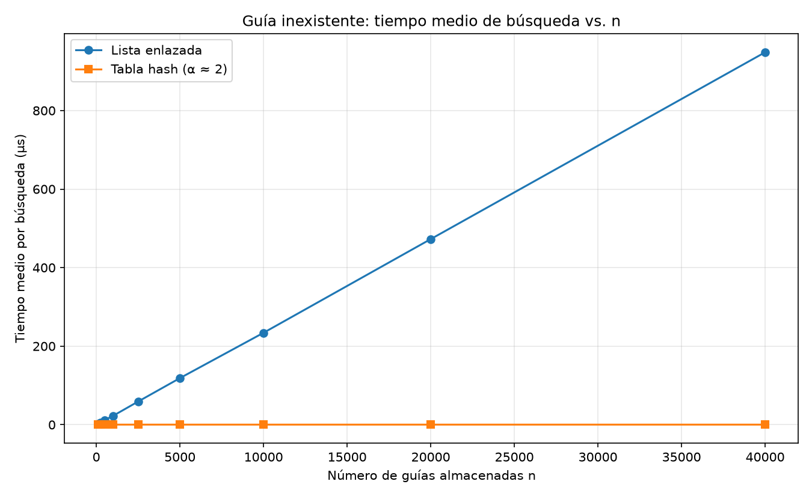
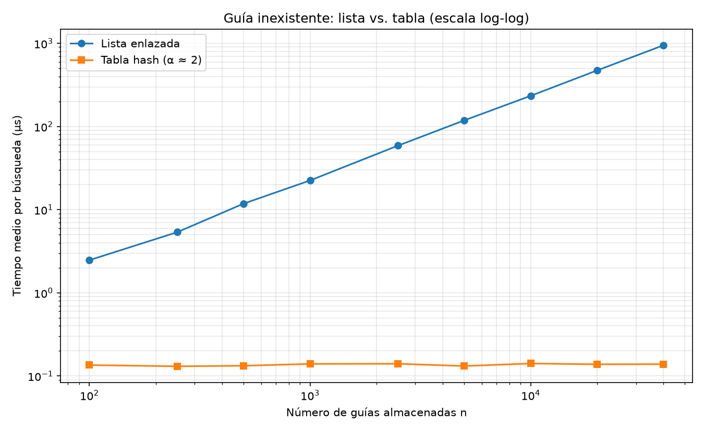
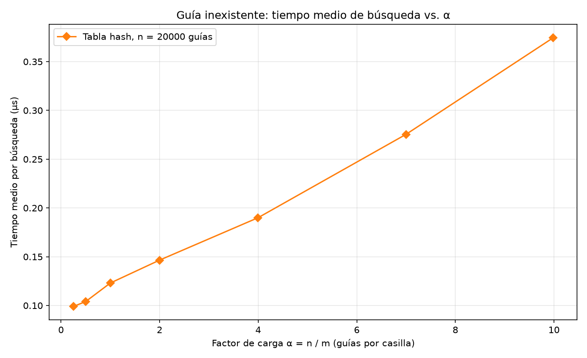

# Laboratorio 3 — Lista enlazada contra tabla hash en la consulta de guías

Informe de **Brayan Alexis Arango Orrego**, Análisis de Algoritmos (ITM, 2026-2).
El caso es el de Rutas del Caribe: el call center consulta el estado de un
envío por su número de guía, y la plataforma actual lo busca en una lista
enlazada que ya no da abasto.

## Reproducción

Desde la raíz del repositorio se activa el entorno virtual (con matplotlib
instalado desde `requirements.txt`):

```bash
source venv/Scripts/activate      # Windows, Git Bash
# venv\Scripts\Activate.ps1       # Windows, PowerShell
# source venv/bin/activate        # Linux / macOS
pip install -r requirements.txt   # solo la primera vez
```

Luego, dentro de la carpeta del laboratorio:

```bash
cd laboratorios/lab3-estructuras-datos
python pruebas.py     # termina con "Todas las pruebas pasaron." o se detiene en el assert que falle
python medicion.py    # imprime las tablas de los experimentos A y B y guarda tres gráficas
```

La medición tarda unos 15 segundos. Los valores de este informe salieron de un
portátil con Windows.

---

## Parte 1 — Implementar y verificar las dos estructuras

Las dos clases están en [estructuras.py](estructuras.py) y la verificación en
[pruebas.py](pruebas.py).

`ListaEnlazada.insertar` pone el nodo nuevo delante de la cabeza, sin recorrer
nada, y `buscar` avanza nodo por nodo con un `while` hasta encontrar la guía o
llegar al final. `TablaHash` tiene un arreglo de `m` listas enlazadas: calcula
la casilla con `guia % m` y le pasa la inserción o la búsqueda solo a la lista
de esa casilla. Ninguna de las dos usa `dict`, `set` ni la función `hash()` de
Python.

En `pruebas.py` se comprobó lo siguiente:

- Con las cuatro guías del enunciado, la lista y la tabla encuentran cada guía
  con su estado y devuelven `None` para una guía mal digitada (`1000000011`) y
  para una lejana. También se revisa que la última guía insertada quede en la
  cabeza, porque la inserción es al inicio.
- La colisión pedida: con `m = 7`, las guías 10, 24 y 17 dan casilla 3; las
  tres se encuentran después de insertarlas, la casilla 3 tiene longitud 3 y
  las otras seis quedan vacías. Además, la guía 31, que cae en la misma casilla
  pero no se insertó, devuelve `None`.
- `factor_carga()` vale exactamente 3/7 después de esas inserciones.
- Un caso extra: con `m = 7`, tres de las guías reales del enunciado
  (1000000010, 1000000024 y 1000000017) también caen juntas, en la casilla 2.
- 25 colecciones aleatorias con semilla fija, de 1 a 400 guías y con `m`
  elegido entre 1, 2, 5, 13, 97 y 401, para tener desde tablas que son una sola
  lista hasta tablas casi sin choques. En cada una se buscan todas las guías
  guardadas y 30 que no existen; la lista y la tabla tienen que responder lo
  mismo, y la suma de las longitudes de las casillas tiene que dar `n`.
- Casos límite: buscar en una lista vacía y en una tabla vacía.

---

## Parte 2 — Medir y graficar

El código de los dos experimentos está en [medicion.py](medicion.py).

**Procedimiento.** Las guías son enteros distintos de diez dígitos generados
con `random.Random(2026)`, y en cada tamaño la lista y la tabla se llenan con la
misma colección. Las 200 guías inexistentes salen de la función
`generar_guias_inexistentes` que entrega la guía (semilla 7). Antes de medir,
el script confirma con 40 guías existentes tomadas al azar que las dos
estructuras devuelven el mismo estado. El cronómetro (`time.perf_counter()`)
solo encierra el ciclo de las 200 búsquedas: crear los datos y llenar las
estructuras queda por fuera. Cada valor es la **mediana de 15 rondas** de esas
200 búsquedas, expresada como tiempo medio por búsqueda en microsegundos (µs).
Para el número de casillas se usó el **primer primo mayor o igual** al valor
buscado (n/2 en el experimento A y n/α en el B).

### Experimento A — Lista frente a tabla (α ≈ 2)



En la gráfica lineal la tabla queda pegada al eje, así que se agrega la misma
medición en escala log-log, donde se ven las dos curvas:



| n | m | α | Lista (µs) | Tabla (µs) |
|---:|---:|---:|---:|---:|
| 100 | 53 | 1,89 | 2,474 | 0,135 |
| 250 | 127 | 1,97 | 5,365 | 0,131 |
| 500 | 251 | 1,99 | 11,829 | 0,133 |
| 1.000 | 503 | 1,99 | 22,466 | 0,140 |
| 2.500 | 1.259 | 1,99 | 58,861 | 0,141 |
| 5.000 | 2.503 | 2,00 | 118,550 | 0,132 |
| 10.000 | 5.003 | 2,00 | 233,996 | 0,141 |
| 20.000 | 10.007 | 2,00 | 472,591 | 0,138 |
| 40.000 | 20.011 | 2,00 | 948,397 | 0,139 |

### Experimento B — Efecto del factor de carga (n = 20.000)



| m | α | Tabla (µs) |
|---:|---:|---:|
| 80.021 | 0,25 | 0,099 |
| 40.009 | 0,50 | 0,104 |
| 20.011 | 1,00 | 0,123 |
| 10.007 | 2,00 | 0,147 |
| 5.003 | 4,00 | 0,190 |
| 2.857 | 7,00 | 0,275 |
| 2.003 | 9,99 | 0,375 |

---

## Parte 3 — Análisis

### 1. Costo teórico

En una lista enlazada, cuando se busca una guía que no existe, toca revisar los nodos uno por uno hasta llegar al final. Por eso, si hay n guías, el costo de la búsqueda es Θ(n). En cambio, la tabla hash calcula primero la casilla usando guia % m y después revisa únicamente la lista que está en esa posición. Si las guías se distribuyen de manera uniforme entre las casillas, en promedio habrá α = n/m guías por lista, así que el costo esperado es Θ(1 + α). Esto supone que las guías quedan repartidas de forma más o menos pareja. Si por alguna razón todas terminan en la misma casilla, la tabla pierde esa ventaja y su búsqueda también puede llegar a Θ(n).

### 2. Lo medido contra lo esperado

Los resultados del experimento A coinciden con lo que se esperaba. Al pasar de 10.000 a 20.000 guías, el tiempo de la lista pasó de 234,0 a 472,6 µs, es decir, aumentó aproximadamente 2,02 veces. De 20.000 a 40.000 volvió a duplicarse, con un factor cercano a 2,01. Esto se acerca al comportamiento Θ(n), porque al duplicar la cantidad de guías también se duplica el trabajo de búsqueda. La tabla, por su parte, se mantuvo alrededor de 0,14 µs y sus cambios fueron muy pequeños, como se espera de una búsqueda Θ(1) cuando el factor de carga se mantiene casi constante.

En el experimento B se ve otro comportamiento: al aumentar α de 0,25 a 10, el tiempo subió de 0,099 a 0,375 µs. Tiene sentido porque, aunque la tabla hace el cálculo de la casilla en un solo paso, cuando hay más guías por casilla debe revisar una lista más larga. Esto concuerda con el costo esperado de Θ(1 + α).

### 3. Las colisiones

Una colisión ocurre cuando dos guías diferentes producen el mismo resultado al calcular guia % m. Esto puede pasar incluso si hay más casillas que guías, porque la función no busca una casilla vacía: simplemente asigna la posición según el residuo. Por ejemplo, con m = 7, las guías 10, 24 y 17 terminan en la casilla 3.

En el encadenamiento, que es lo usado en este laboratorio, las guías que chocan se guardan en una lista enlazada dentro de la misma casilla. Es sencillo de implementar y permite que varias guías compartan posición, aunque las búsquedas se hacen más lentas si esa lista crece. El direccionamiento abierto funciona distinto: cuando una casilla ya está ocupada, busca otra posición libre dentro del arreglo. Así no necesita listas adicionales, pero debe aplicar una estrategia para encontrar y recorrer esas posiciones, y puede complicarse cuando la tabla está muy llena.

### 4. ¿Tabla hash o árbol de búsqueda?

La tabla hash es conveniente cuando se necesita consultar una guía específica, porque con una buena distribución puede encontrarla en tiempo constante en promedio. Sin embargo, no mantiene las guías ordenadas. Si se quisiera consultar cuáles envíos tienen una guía entre un valor X y otro Y, habría que revisar las casillas de la tabla, ya que no se puede recorrer directamente ese intervalo.

Para ese tipo de consulta sería más útil un árbol binario de búsqueda, porque mantiene las claves ordenadas y permite recorrer solo los valores que están dentro del rango. Hay que tener en cuenta que un árbol sin equilibrar puede salir bastante mal: si se insertan las 400.000 guías en orden, puede quedar como una cadena, con una altura cercana a 400.000 y búsquedas que llegan a esa cantidad de comparaciones. Si se mantiene equilibrado, su altura sería aproximadamente log₂(400.000), es decir, unas 19 comparaciones para llegar a una clave.

### 5. Concepto para la jefa de operaciones

Mi recomendación sería no usar una sola estructura para todas las consultas. Utilizaría una tabla hash para buscar rápidamente el estado de un envío cuando se conoce su número de guía, y un árbol de búsqueda equilibrado para las consultas por rangos. Así se aprovecha lo mejor de cada estructura según el tipo de consulta.

Para estimar qué pasaría con 5.000.000 de envíos, la lista enlazada tendría un tiempo aproximado de 948,4 µs × 125, porque esa cantidad es 125 veces mayor que las 40.000 guías medidas. El resultado es 118.550 µs, o cerca de 0,12 segundos por consulta. En la tabla hash, si se conserva un factor de carga parecido y una distribución uniforme, el tiempo debería mantenerse cerca de los 0,14 µs observados. Son estimaciones, no mediciones reales con cinco millones de registros, pero la diferencia se justifica por las tendencias de las gráficas: la lista crece casi en línea recta y la tabla se mantiene prácticamente plana cuando α no cambia.
